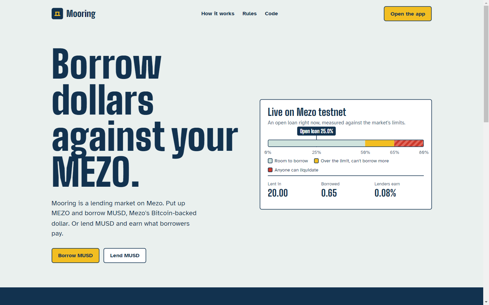
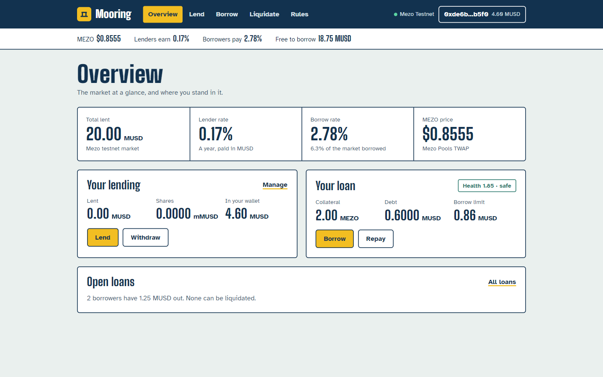
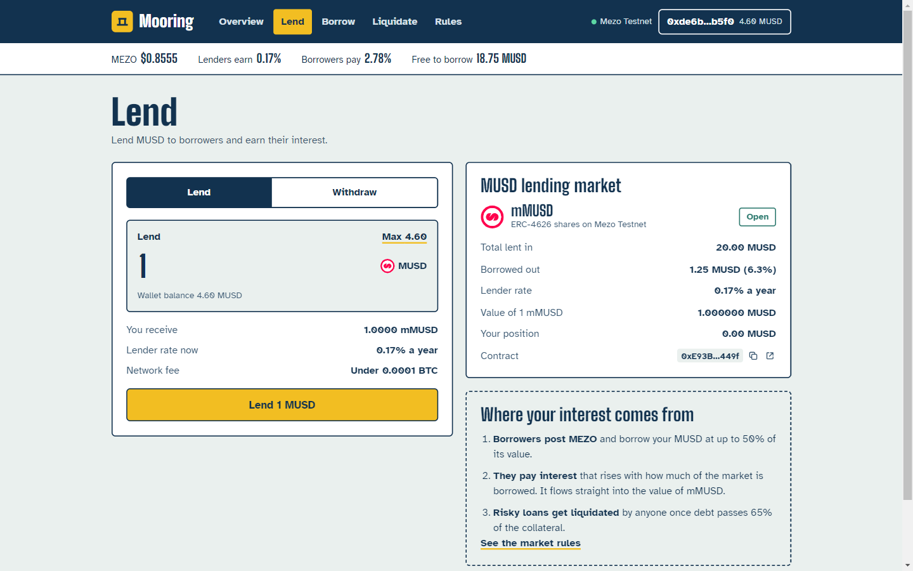
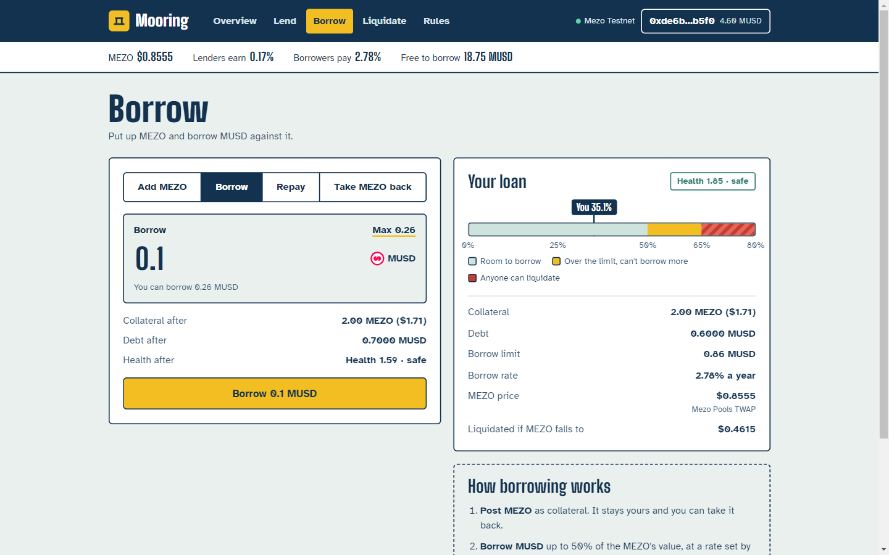
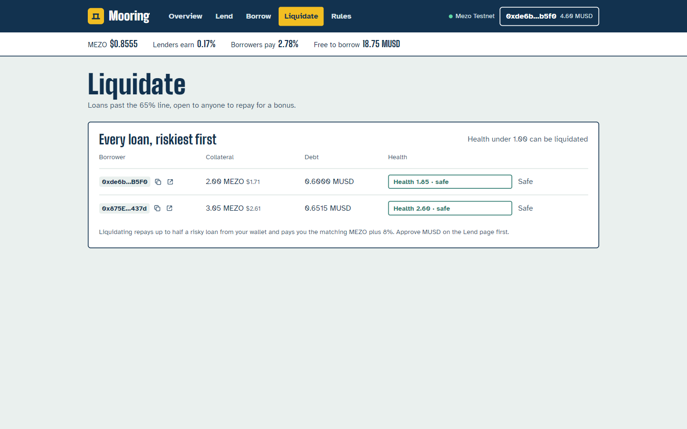

# Mooring Finance

**Keep your MEZO. Borrow the dollars.**

Mooring is an isolated money market on Mezo. MUSD holders lend into it and earn the interest borrowers pay. MEZO holders post MEZO as collateral and borrow MUSD against it, without selling. Anyone can liquidate a loan that gets too risky, and keeps an 8% bonus for doing it.

**Network:** Mezo testnet (chain 31611) · **Track:** Track 1, DeFi · **Code:** [github.com/fahmmin/mooring-finance](https://github.com/fahmmin/mooring-finance)

---

## Screenshots



| Overview | Lend |
|---|---|
|  |  |
| **Borrow** | **Liquidate** |
|  |  |

---

## Why

MEZO today can be locked for veMEZO votes, and that's about it. Of the 44 Wave 1 Buildathon entries, only one other treats MEZO as collateral. Mooring makes MEZO productive collateral and gives MUSD a lending market to earn in: the first two lines of Track 1's brief ("lending protocols accepting MUSD/MEZO as collateral").

It also composes with the rest of Mezo:

- **Mezo Pools** price MEZO, using the MEZO/MUSD pool's own time-weighted average.
- **mMUSD is a standard ERC-4626 share**, so yield vaults can park idle MUSD in it without custom code.
- **Borrowed MUSD** can go straight into Mezo Pools or the Savings Vault.

---

## How it works

```
 Lenders ── MUSD ──▶ ┌─────────────────────┐ ◀── MEZO ── Borrowers
         ◀─ mMUSD ── │   MooringMarket     │ ── MUSD ──▶ (≤ 50% of MEZO value)
                     │  ERC-4626 + loans   │
 Liquidators ─ MUSD ▶│  liquidate > 65%    │── MEZO + 8% ▶ Liquidators
                     └──────────┬──────────┘
                                │ price()
                     PoolTwapOracle ── quote(MEZO, 1e18, 4) ──▶ Mezo Pools MEZO/MUSD
```

| Rule | Value | Enforced where |
|---|---|---|
| Borrow limit (LTV) | 50% of collateral value | `borrow`, `withdrawCollateral` |
| Liquidation line | debt above 65% of collateral value | `liquidate` |
| Liquidator bonus | 8% extra MEZO | `liquidate` |
| Close factor | at most 50% of the debt per liquidation | `liquidate` |
| Interest | 2% idle, 12% at 80% borrowed, up to 112% at 100% | `borrowRate` |
| Lender exits | withdraw anything not lent out | `maxWithdraw`, `maxRedeem` |
| Owner powers | can only change the price source; no pause, no upgrade, no access to funds | `setOracle` |

Interest accrues per second into a borrow index. Lenders' share price (`convertToAssets`) includes interest that hasn't been written to storage yet, so mMUSD is always priced correctly.

---

## Live on Mezo testnet

| Contract | Address |
|---|---|
| MooringMarket (mMUSD) | [`0xE93B1c06486EEaD1Fd5452B0829f51cc9E29449f`](https://explorer.test.mezo.org/address/0xE93B1c06486EEaD1Fd5452B0829f51cc9E29449f) |
| PoolTwapOracle | [`0xb00B476C32a95A215B53389cb0Fbe92F56260802`](https://explorer.test.mezo.org/address/0xb00B476C32a95A215B53389cb0Fbe92F56260802) |
| Mezo Pools MEZO/MUSD (price source) | [`0x8eb88d745B0aFFF9D71AbC40d7F550Cded7bB342`](https://explorer.test.mezo.org/address/0x8eb88d745B0aFFF9D71AbC40d7F550Cded7bB342) |
| MUSD | [`0x118917a40FAF1CD7a13dB0Ef56C86De7973Ac503`](https://explorer.test.mezo.org/address/0x118917a40FAF1CD7a13dB0Ef56C86De7973Ac503) |
| MEZO | [`0x7B7c000000000000000000000000000000000001`](https://explorer.test.mezo.org/address/0x7B7c000000000000000000000000000000000001) |

Seeded with 20 MUSD of lender liquidity at deploy, plus a standing demo loan (3.05 MEZO collateral, 0.65 MUSD debt, health 2.60).

---

## Tests

- **6 contract tests** (`cd contracts && npx hardhat test`): borrow limit, interest to lenders, lender exit limits, liquidation threshold/bonus/close factor, underwater seizure cap, pool TWAP pricing and owner-only oracle changes.
- **1 end-to-end test with real MetaMask** (`cd e2e && npx playwright test`): Synpress drives MetaMask 13 on Mezo testnet through connect + network switch, input validation, lend → withdraw, deposit MEZO → borrow → repay in full → take MEZO back, then checks every page renders live data.

---

## Run it

```bash
cp .env.example .env            # testnet-only keys
cd contracts && npm i && npx hardhat test
npx hardhat run scripts/deploy.js --network mezotestnet
npx hardhat run scripts/buy-mezo.js --network mezotestnet   # MEZO for the e2e wallet
npx hardhat run scripts/demo-loan.js --network mezotestnet  # a standing borrower to show
cd ../app && npm i && npm run dev                           # http://localhost:5173
cd ../e2e && npm i && node build-cache.mjs && npx playwright test
```

On Windows, `node build-cache.mjs` builds Synpress's MetaMask cache (Synpress's own CLI only runs on Linux, macOS or WSL).

---

## Known limits (testnet)

- **Price source.** Pyth's testnet MEZO/USD feed has never been pushed, and Hermes now needs an API key, so testnet prices MEZO from the Mezo Pools MEZO/MUSD TWAP. That pool is small and rarely traded, so its TWAP is easy to move over hours. On mainnet: Pyth MEZO/USD, with the pool TWAP as a sanity bound.
- **Bad debt.** If MEZO crashes faster than liquidators act, debt left on a position with no collateral is absorbed by lenders. A reserve fund taken from interest is the Wave 2 fix.
- **Unaudited.** Hackathon code. Don't use real funds.

## Roadmap

Wave 2 (Nov 2–15): capped mainnet launch with a Pyth price, a market factory with an sMUSD market, a reserve fund with invariant tests, a liquidation keeper with Telegram alerts, and lender rewards through a Mezo Earn gauge. Details in [docs/demo-video.md](docs/demo-video.md#wave-2-milestones-nov-2--nov-15).

---

## AKINDO submission

**Deliverable URL:** [github.com/your-account/mooring-finance] · **Video:** [public YouTube link] · **Live demo:** [hosted app link]

**Build with:** Mezo · Mezo Testnet · MUSD · MEZO · Mezo Pools

**Product category:** Lending · DeFi · Money Market

### What it does

Mooring is an isolated money market on Mezo. MUSD holders lend into it and earn the interest borrowers pay, as mMUSD (ERC-4626) shares that grow over time. MEZO holders post MEZO as collateral and borrow MUSD at up to 50% of its value, without selling. When a loan's debt passes 65% of its collateral, anyone can repay up to half of it and collect the matching MEZO plus an 8% bonus. MEZO is priced from the Mezo Pools MEZO/MUSD pool's time-weighted average.

### The problem it solves

MEZO has one use today: being locked as veMEZO to boost votes. Holders who need dollars have to sell it and give up the upside. On the other side, MUSD has few places to earn: on Oct 25, 2026, DefiLlama showed about $64M in Mezo Earn and $7.4M in Mezo's vaults, but next to nothing in lending markets on Mezo. Mooring turns MEZO into collateral and gives MUSD a lending market.

### Challenges I ran into

- **No live MEZO price on testnet.** Pyth's MEZO/USD feed has never been pushed on Mezo testnet, and its BTC and MUSD feeds were about 90 days old. Hermes now needs an API key to fetch updates. We priced MEZO from the Mezo Pools MEZO/MUSD pool's own TWAP instead, and planned Pyth for mainnet.
- **A rate model that called itself.** Interest accrual read utilisation, which read total borrows, which accrued interest. The first test run hit infinite recursion; the fix fixes each period's rate at the debt from the last accrual, the way Compound does.
- **Mezo RPC quirks.** Gas estimates from the wallet were too low (we estimate from the address and add 30%), log queries are capped at 10,000 blocks (we page through them), and a read straight after a transaction can return stale state.
- **Real-wallet testing on Windows.** Synpress's cache builder only runs on Linux, macOS or WSL, and MetaMask 13 renamed its screens. We wrote a small shim to build the cache on Windows and drive the popups by their button labels.
- **A race in the amount box.** The app cleared the amount only after reloading balances, which wiped anything typed in those seconds. The end-to-end test caught it.

### Technologies I used

Solidity 0.8.28, OpenZeppelin 5.1 (ERC-4626, SafeERC20, Math), Hardhat, ethers; React 19, Vite, TypeScript, viem; Playwright and Synpress with MetaMask 13; Mezo testnet, MUSD, MEZO and the Mezo Pools MEZO/MUSD pool.

### How we built it

1. Read Mezo's docs and the MUSD contracts, and all 44 Wave 1 entries, to find a gap: MEZO as collateral.
2. Wrote `MooringMarket` (an ERC-4626 vault plus per-borrower collateral and a borrow index) and `PoolTwapOracle`, test-first, with 6 Hardhat tests covering limits, interest, lender exits, liquidations and pricing.
3. Deployed to Mezo testnet from a dedicated wallet, seeded 20 MUSD of liquidity, and opened a standing demo loan.
4. Built the app: Overview, Lend, Borrow (with a loan-to-value ruler), Liquidate and Rules pages, all reading live chain data.
5. Covered the full user flow with a Synpress test in real MetaMask: connect and switch network, lend and withdraw, post MEZO, borrow, repay in full and take the MEZO back.

### What we learned

- Mezo testnet is fast (about 4 seconds from signing to confirmation), but its RPC needs care: page your log queries, pad gas, and expect a stale read right after a write.
- An isolated market is the quickest safe start: one collateral and one borrowable asset keep the risk easy to explain.
- Testing with a real wallet finds bugs that unit tests can't, like the amount box race.

### What's next for Mooring Finance

Wave 2 (Nov 2–15):

1. **Mainnet launch, capped**, with Pyth MEZO/USD bounded by the Mezo Pools average.
2. **Market factory**, shipping a second market with sMUSD as collateral.
3. **Safety**: a reserve fund from interest, invariant fuzz tests and timelocked parameters.
4. **Liquidation keeper** and Telegram alerts for borrowers.
5. **MEZO rewards for lenders** through a Mezo Earn gauge on an mMUSD/MUSD pool.
